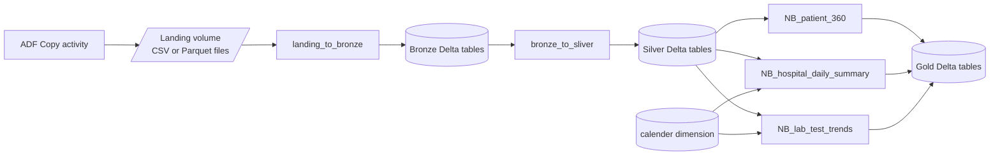

# CareSync Health Data Platform: Databricks Notebooks

PySpark and SQL notebooks that implement the **Landing → Bronze → Silver → Gold** medallion layers of the CareSync platform. They are called by Azure Data Factory (`PL_Source_to_Silver_Inner` and `Pl_Silver_to_Gold`) and are driven by parameters from the ADF control table, so one pair of notebooks handles every source table. Gold tables are built with SQL (CTAS) from the Silver layer.

**Stack:** Azure Databricks · PySpark · Spark SQL · Delta Lake · Unity Catalog (volumes and tables) · ADLS Gen2

> The ADF orchestration is documented in the ADF repo's README. This repo covers only the notebooks.

---

## Table of contents

1. [Architecture](#architecture)
2. [Repository structure](#repository-structure)
3. [Catalog layout](#catalog-layout)
4. [Notebook 1: landing_to_bronze](#notebook-1-landing_to_bronze)
5. [Notebook 2: bronze_to_sliver](#notebook-2-bronze_to_sliver)
6. [Gold layer](#gold-layer)
7. [Parameters passed from ADF](#parameters-passed-from-adf)
8. [Load types](#load-types)
9. [Setup guide](#setup-guide)
10. [How to test a notebook manually](#how-to-test-a-notebook-manually)
11. [Design decisions](#design-decisions)
12. [Known limitations and improvements](#known-limitations-and-improvements)

---

## Architecture



1. ADF copies source data into the **landing volume**, in a folder per source system, table and run timestamp.
2. `landing_to_bronze` reads that folder, adds metadata columns and appends to a **Bronze** Delta table.
3. `bronze_to_sliver` reads only the rows of the current run from Bronze and writes to **Silver** according to the load type.
4. Gold notebooks build the reporting tables from Silver, joined with a shared **calendar dimension**.

---

## Repository structure

> Adjust to match your repo.

```
.
├── landing_to_bronze.py            # Landing → Bronze
├── bronze_to_sliver.py             # Bronze → Silver (FULL, APPEND, MERGE)
├── Gold/
│   ├── NB_patient_360.sql
│   ├── NB_hospital_daily_summary.sql
│   └── NB_lab_test_trends.sql
├── setup/
│   └── create_calender.sql         # one-time: calendar dimension table
└── README.md
```

ADF calls the Gold notebooks by name (`Gold/NB_<gold_table_name>`), so the notebook name must match `gold_table_name` in `ctrl.table_config`.

---

## Catalog layout

| Layer | Location |
|---|---|
| Landing | Unity Catalog volume: `/Volumes/databricks_worksoace/landing/landing_volume/` |
| Bronze | `databricks_worksoace.bronze.<table>` |
| Silver | `databricks_worksoace.silver.<table>` |
| Gold | `databricks_worksoace.gold.<table>` |
| Calendar dimension | `databricks_worksoace.default.calender` |

Landing path convention:

```
/Volumes/databricks_worksoace/landing/landing_volume/<source_system>/<table_name>/<landing_timestamp>/
```

Example: `.../adls_csv/insurance_providers/2026-10-15_10-52-20/`

> `landing_volume` must be an **external volume** whose location is the root of the `landing` storage container. Otherwise files written by ADF are not visible to the notebooks.

---

## Notebook 1: `landing_to_bronze`

**Purpose:** load the files ADF dropped for the current run into a Bronze Delta table.

**Steps**

1. **Create widgets and read parameters:** `source_system`, `table_name`, `landing_timestamp`, `source_file_format`.
2. **Build the landing path** from those parameters.
3. **Check for files:** if the folder is missing or empty, the notebook prints a message and exits. This is the normal outcome of an incremental run with no new data.
4. **Read the data:**
   - `source_file_format == "csv"`: CSV with header and schema inference
   - otherwise: Parquet
5. **Add metadata columns:**
   - `landing_timestamp`: the folder timestamp of this run (used later to select the batch)
   - `insert_timestamp`: `current_timestamp()`
6. **Append** to `databricks_worksoace.bronze.<table_name>`.

Bronze is **append-only**. It keeps every batch, tagged with its `landing_timestamp`, which makes loads traceable and replayable.

```python
update_df = landing_df.withColumn("landing_timestamp", lit(landing_timestamp)) \
                      .withColumn("insert_timestamp", current_timestamp())

update_df.write.mode("append").saveAsTable(f"databricks_worksoace.bronze.{table_name}")
```

---

## Notebook 2: `bronze_to_sliver`

**Purpose:** move the current batch from Bronze to Silver using the configured load type.

**Steps**

1. **Create widgets and read parameters:** `landing_timestamp`, `table_name`, `merge_keys`, `load_type`.
2. **Read only this run's batch:**
   ```python
   bronze_df = spark.read.table(f"databricks_worksoace.bronze.{table_name}") \
                    .filter(f"landing_timestamp = '{landing_timestamp}'")
   ```
3. **Validate inputs:** for `MERGE`, `merge_keys` must be present and every key must exist in the data, otherwise the notebook raises a clear error.
4. **Add `insert_timestamp` and `update_timestamp`.**
5. **Write to Silver** according to the load type (see [Load types](#load-types)).

---

## Gold layer

The Gold layer is built from Silver with **Spark SQL**. Each notebook uses `CREATE OR REPLACE TABLE ... USING DELTA AS SELECT ...`, which fully rebuilds the table on every run (consistent with `load_type = FULL` for the Gold rows in `ctrl.table_config`). Each notebook ends by counting the rows and returning the count to ADF:

```python
record_count = spark.table("databricks_worksoace.gold.<table>").count()
dbutils.notebook.exit(str(record_count))
```

ADF stores this number in `ctrl.audit_log.records_written`.

### Calendar dimension: `default.calender`

A date dimension generated once with `sequence()` from **1940-01-01 to 2030-12-31** (one row per day). It is joined on `date_key` (`yyyyMMdd` as an integer) to add readable date attributes to the Gold tables.

Main columns: `date_key`, `date`, `year`, `quarter`, `quarter_name`, `year_quarter`, `half_year`, `month`, `month_name`, `month_short_name`, `year_month_key`, `year_month`, `day_of_month`, `day_of_week`, `iso_day_of_week`, `day_name`, `day_short_name`, `day_of_year`, `week_of_year`, `year_week`, `week_start_date`, `week_end_date`, `month_start_date`, `month_end_date`, `quarter_start_date`, `quarter_end_date`, `year_start_date`, `year_end_date`, and the flags `is_month_start`, `is_month_end`, `is_quarter_start`, `is_quarter_end`, `is_year_start`, `is_year_end`, `is_weekend`.

> The range starts in 1940 so that patient birth dates are covered as well. **Run this notebook once before the first Gold run**, because ADF does not create it.

### Gold table 1: `gold.patient_360`

One row per patient, with demographics, hospital, insurance provider and a summary of lab activity.

| Source (Silver) | Use |
|---|---|
| `patients` | Base table (demographics, hospital and insurance IDs) |
| `hospitals` | `hospital_name` |
| `insurance_providers` | `insurance_provider_name` |
| `lab_results` | Aggregated per patient: total, abnormal and critical tests, last test date |

Key columns: `patient_id`, `first_name`, `last_name`, `date_of_birth`, `age`, `gender`, `city`, `state`, `hospital_id`, `hospital_name`, `insurance_provider_id`, `insurance_provider_name`, `total_tests`, `abnormal_test_count`, `critical_test_count`, `last_test_date`.

Logic notes:
- `age` is calculated from `date_of_birth` as `FLOOR(DATEDIFF(current_date, dob) / 365.25)`.
- LEFT JOINs keep patients without lab results. Their test counts are set to 0 with `COALESCE`.

### Gold table 2: `gold.hospital_daily_summary`

One row per hospital per day, with test volumes, quality rates and day-over-day change.

| Source | Use |
|---|---|
| `silver.lab_results` | Daily aggregates per hospital |
| `silver.hospitals` | `hospital_name` |
| `default.calender` | `day_name`, `is_weekend` |

Metrics: `total_tests`, `unique_patients_tested`, `active_doctor_count`, `abnormal_test_count`, `critical_test_count`, `abnormal_rate_pct`, `critical_rate_pct`, `prev_day_total_tests`, `test_volume_change_pct`.

Logic notes:
- The query is built in three CTE steps: daily aggregation, rates and joins, then window functions.
- `prev_day_total_tests` uses `LAG` over `PARTITION BY hospital_id ORDER BY summary_date`. It returns the previous **row**, which is the previous day **with data**, not necessarily the previous calendar day.
- `test_volume_change_pct` is `NULL` when there is no previous row or it is 0, which avoids division by zero.

### Gold table 3: `gold.lab_test_trends`

One row per test type per month, showing how abnormal and critical rates move over time.

| Source | Use |
|---|---|
| `silver.lab_results` | Monthly aggregates per `test_name` |
| `default.calender` | `month_name`, `quarter_name` (joined on the first day of the month) |

Metrics: `total_tests`, `abnormal_test_count`, `critical_test_count`, `abnormal_rate_pct`, `critical_rate_pct`, `prev_month_abnormal_rate_pct`, `abnormal_rate_change_pct`.

Logic notes:
- `prev_month_abnormal_rate_pct` uses `LAG` over `PARTITION BY test_name ORDER BY year, month`.
- `abnormal_rate_change_pct` is the difference in percentage points from the previous month.

### Gold dependency map

| Gold table | Silver tables | Calendar |
|---|---|---|
| `patient_360` | `patients`, `hospitals`, `insurance_providers`, `lab_results` | No |
| `hospital_daily_summary` | `lab_results`, `hospitals` | Yes |
| `lab_test_trends` | `lab_results` | Yes |

The three notebooks are independent, so ADF runs them in parallel in a ForEach.

---

## Parameters passed from ADF

| Parameter | Used by | Source in ADF |
|---|---|---|
| `source_system` | landing_to_bronze | `table_config.source_system` |
| `table_name` | landing_to_bronze | `table_config.bronze_table_name` |
| `landing_timestamp` | both | `Start_time` variable of the inner pipeline |
| `source_file_format` | landing_to_bronze | `table_config.source_file_format` (default `parquet`) |
| `table_name` | bronze_to_sliver | `table_config.silver_table_name` |
| `load_type` | bronze_to_sliver | `table_config.load_type` |
| `merge_keys` | bronze_to_sliver | `table_config.merge_keys` (empty string if none) |

Gold notebooks take no parameters. ADF only chooses the notebook from `gold_table_name`.

---

## Load types

Used by `bronze_to_sliver`.

| Load type | Silver behaviour | Notes |
|---|---|---|
| `FULL` | `overwrite` the Silver table | Idempotent. Used for small reference tables. |
| `APPEND` | `append` the batch | Used for event-like data (for example lab results). A re-run adds the rows again. |
| `MERGE` | `MERGE INTO` on `merge_keys`: update matches, insert new rows | First run creates the table. `insert_timestamp` is kept on update. |

The MERGE statement is built dynamically from the column list:

```sql
MERGE INTO <target> AS target
USING silver_merge_source AS source
ON target.`key1` = source.`key1` AND ...
WHEN MATCHED THEN UPDATE SET <all columns except insert_timestamp>
WHEN NOT MATCHED THEN INSERT (...) VALUES (...)
```

Any other value raises: `load_type must be one of: FULL, APPEND, MERGE`.

---

## Setup guide

1. **Unity Catalog:** create the catalog `databricks_worksoace` and the schemas `landing`, `bronze`, `silver`, `gold` (the `default` schema holds the calendar).
2. **External volume:** create `landing.landing_volume` pointing at the root of the `landing` ADLS Gen2 container (needs a storage credential and an external location).
3. **Permissions:** the identity used by ADF needs `USE CATALOG`, `USE SCHEMA`, `READ VOLUME`, and `CREATE TABLE` / `MODIFY` on the target schemas.
4. **Import the notebooks:** connect the repo as a Git folder, for example `/Care_Sync_repo/caresync-health-data-platform_databricks/`.
5. **Create the calendar once:** run `setup/create_calender.sql`.
6. **ADF linked service:** `LS_AzureDatabricks` with access to the workspace and a cluster (job cluster or existing cluster).

---

## How to test a notebook manually

### Landing to Bronze

Run `landing_to_bronze` with these widget values:

| Widget | Example |
|---|---|
| `source_system` | `adls_csv` |
| `table_name` | `insurance_providers` |
| `landing_timestamp` | newest folder name under the landing path |
| `source_file_format` | `csv` |

Find available folders:

```python
display(dbutils.fs.ls("/Volumes/databricks_worksoace/landing/landing_volume/adls_csv/insurance_providers/"))
```

Check the result:

```sql
SELECT landing_timestamp, COUNT(*) FROM databricks_worksoace.bronze.insurance_providers GROUP BY 1;
```

### Bronze to Silver

Run `bronze_to_sliver` with the silver `table_name`, the same `landing_timestamp`, a `load_type` and `merge_keys`.

### Gold

Run a Gold notebook directly (no parameters), then check:

```sql
SELECT * FROM databricks_worksoace.gold.hospital_daily_summary ORDER BY summary_date DESC LIMIT 20;
```

---

## Design decisions

| Decision | Reason |
|---|---|
| One generic notebook per layer, driven by parameters | Adding a table needs no new code, only a config row in ADF |
| Bronze is append-only with `landing_timestamp` | Full history, traceable batches and replay |
| Silver reads only the current batch by `landing_timestamp` | Processes each batch once, and avoids re-reading all of Bronze |
| Dynamic MERGE built from the DataFrame columns | Works for any table schema without hardcoding column names |
| Input validation on `merge_keys` | Fails early with a clear message instead of a cryptic SQL error |
| Empty or missing landing folder exits cleanly | An incremental run with no new data is normal, not an error |
| Gold built with `CREATE OR REPLACE TABLE ... AS` | Simple, atomic full refresh, and Delta keeps history for time travel |
| Shared calendar dimension | One consistent definition of dates, weeks and quarters across Gold tables |
| Percentages calculated with `DECIMAL` casts | Stable, readable rate columns for BI tools |
| Window functions (`LAG`) for trends | Day-over-day and month-over-month change without self-joins |

---

## Known limitations and improvements

- **Return value to ADF:** ADF writes the notebook's exit value into `records_written`. `bronze_to_sliver` and every Gold notebook must end with `dbutils.notebook.exit(str(row_count))` and a plain number. A text value breaks the audit update. The "No new files received" exit in `landing_to_bronze` is not read by ADF.
- **Empty batch in Silver:** if Bronze has no rows for the batch, a `FULL` load would overwrite Silver with an empty table. Add a guard that exits with `"0"` when `bronze_df.isEmpty()`.
- **Duplicate keys in a MERGE batch:** if the source batch holds several rows with the same key, MERGE fails. Deduplicate by key (latest record) before merging.
- **APPEND re-runs:** re-running the same batch adds duplicates. A check on `landing_timestamp` (skip if already in Silver) would make it idempotent.
- **Schema inference for CSV:** `inferSchema` is convenient but can change types between runs. Define explicit schemas for stable tables.
- **Column names:** Delta rejects spaces and special characters. Clean column names before the write if source files may contain them.
- **Gold full refresh:** every run rebuilds each Gold table. For large data, switch to incremental (partition overwrite or MERGE).
- **`LAG` semantics:** previous day or month means the previous **row**. If a hospital has no tests on a day, that day is skipped. Join to the calendar first if gaps must show as 0.
- **Age calculation:** `/ 365.25` is an approximation. Use `months_between` for exact age.
- **Table name spelling:** the calendar table is named `calender`. Keep the spelling consistent in all notebooks, or rename it everywhere.
- **Hardcoded catalog name:** move the catalog name into a parameter or a config cell.
- **Data quality checks:** add null, duplicate and row-count checks, and log the results.
- **Schema evolution:** add `mergeSchema` handling with alerts.

---

## Author

**<Your name>**: Azure Data Engineer
[LinkedIn](#) · [GitHub](#)
